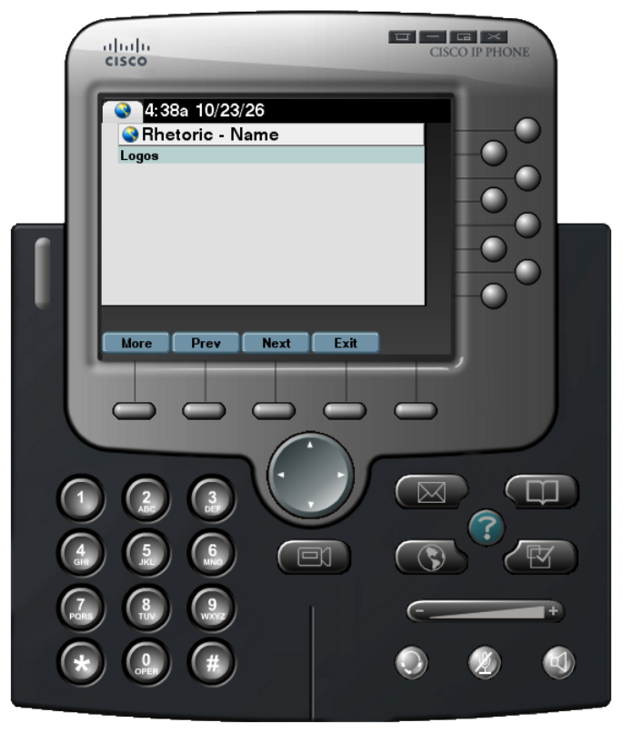

# Rhetoric

  

Rhetoric is the art, study, and practice of effective, persuasive speaking or writing. It investigates how language shapes beliefs, motivates action, and influences an audience.

In an argument, rhetoric is the vehicle that makes logical claims resonant and compelling to a specific audience. While an argument provides the structural backbone (claims, reasons, and evidence), rhetoric determines how those points are delivered and adapted.

Here are a few examples...

Name | Definition | Example
:-- | :-- | :--
Logos | Language crafted to appeal to logic and reasoning, supported with facts and data. | None of the kids were home when the cookie jar was raided, so the cookie thief couldn't have been one of them.
Ethos | Language whose credibility comes from its speaker's reputation or authority. | I started exercising twice per week because my doctor said it would help alleviate my pain.
Pathos| Language that creates an emotional connection with the reader or listener. | Please donate to the animal shelter. We're desperately in need of funding to help our animals, and every dollar counts.
</dev>
